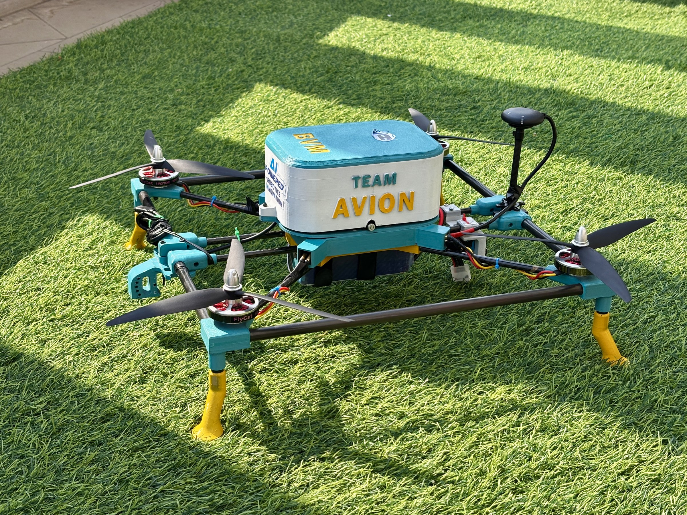
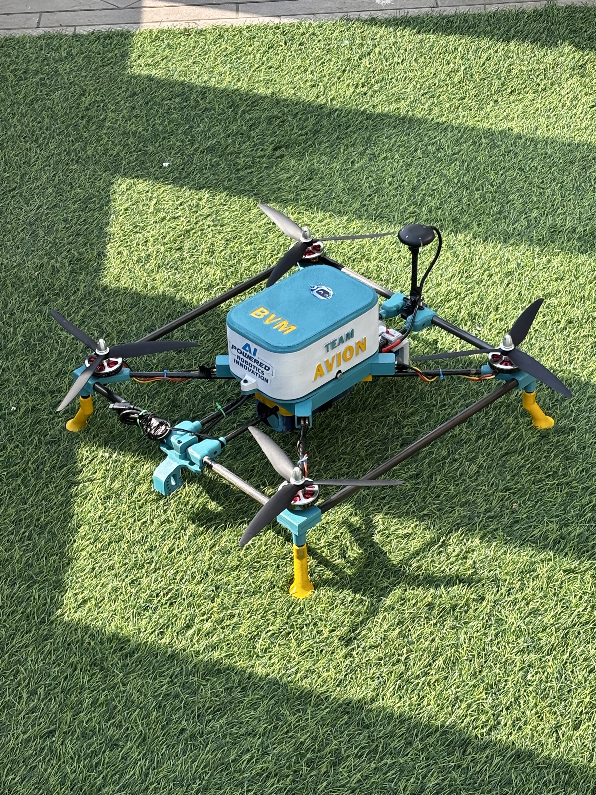
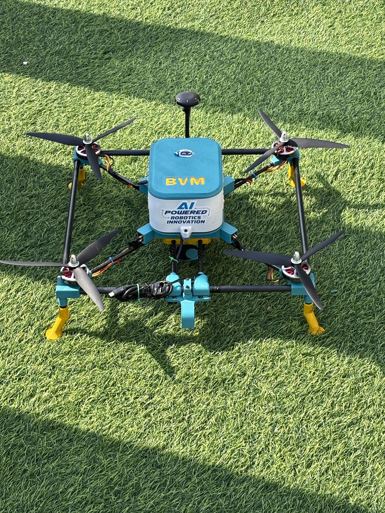
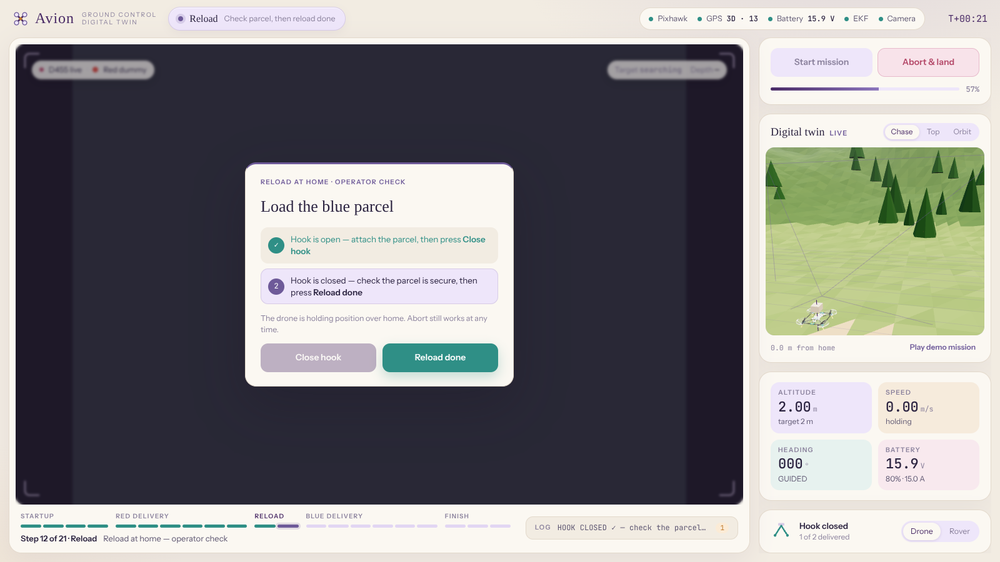
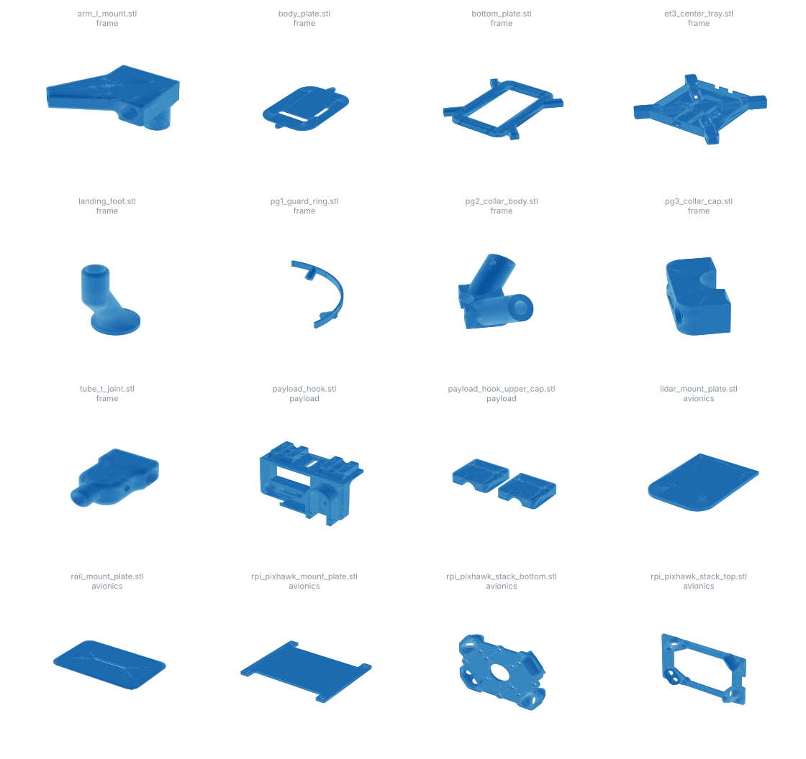

# AVION

**An autonomous disaster-relief drone that delivers medikits and food parcels to people cut off by floods, landslides and earthquakes.**

AVION is a quadcopter built by Team Avion at BVM (Birla Vishvakarma Mahavidyalaya). It has an in-house carbon-fibre and 3D-printed airframe, a Pixhawk autopilot, a Raspberry Pi 4 companion computer and an Intel RealSense D455 depth camera. The drone flies the mission on its own: it searches for a marked drop zone, closes in using depth vision and releases the parcel. A human operator confirms every target and every reload from a browser-based ground station that includes a live 3D digital twin.

Project mentor: Dr. Dipak M. Patel

<p align="center">
  
  
  
</p>

---

## Contents

- [System overview](#system-overview)
- [Repository layout](#repository-layout)
- [Hardware](#hardware)
- [Flight software](#flight-software)
- [Mission sequence](#mission-sequence)
- [Ground control station and digital twin](#ground-control-station-and-digital-twin)
- [Getting started](#getting-started)
- [Configuration reference](#configuration-reference)
- [Bench tests and prototypes](#bench-tests-and-prototypes)
- [CAD](#cad)
- [Flight logs](#flight-logs)
- [Large files](#large-files)
- [Known issues and notes](#known-issues-and-notes)

---

## System overview

```
                ┌──────────────────────── Operator laptop / phone ───────────────────────┐
                │  Browser → http://<pi-ip>:5000   (live video · 3D twin · telemetry ·   │
                │                                   APPROACH / IGNORE · reload · ABORT)  │
                └───────────────────────────────▲────────────────────────────────────────┘
                                                │ Wi-Fi (Flask + Socket.IO, 10 Hz telemetry,
                                                │        MJPEG camera stream)
┌────────────────────────── Raspberry Pi 4 (companion computer) ─────────────────────────┐
│  main.py                                                                               │
│   ├── mission_manager.py   two-phase state machine (red drop → reload → blue drop)     │
│   ├── vision.py            D455 RGB + aligned depth, HSV colour detection, 3 zones      │
│   ├── flight_controller.py DroneKit / MAVLink wrapper, position hold, yaw, servo, watchdog│
│   ├── rover.py             optional ground-drive mode (TB6612 via pigpio, RC CH6)      │
│   └── gui.py + gui_assets/ ground control station served from the Pi (works offline)  │
└───────────────▲───────────────────────────────────────────────▲────────────────────────┘
                │ USB (MAVLink, /dev/ttyACM0 @ 57600)            │ USB 3
┌───────────────┴─────────────────┐                   ┌─────────┴──────────────┐
│ Pixhawk 2.4.8 · ArduCopter 4.7  │                   │ Intel RealSense D455   │
│ GPS · ESCs · AUX1 → payload hook│                   │ 640×480 @ 15 fps RGB-D │
└─────────────────────────────────┘                   └────────────────────────┘
```

## Repository layout

```
AVION/
├── flight_software/          Code that runs on the Raspberry Pi (run from this folder)
│   ├── main.py               Entry point: connects Pixhawk + camera, starts mission, rover, GUI
│   ├── config.py             All tunable parameters (edit before every flight)
│   ├── mission_manager.py    Autonomous state machine with operator confirmation
│   ├── flight_controller.py  DroneKit/MAVLink wrapper: arm, takeoff, velocity, yaw, servo, watchdog
│   ├── vision.py             RealSense D455 pipeline: red/blue detection, depth sampling, HUD
│   ├── rover.py              Ground-drive mode: RC-controlled differential drive
│   ├── gui.py                Flask + Socket.IO ground control station (port 5000)
│   ├── calibrate_hsv.py      Web HSV tuner (port 5001); writes thresholds into config.py
│   ├── logger.py             Timestamped file + console logging to logs/
│   ├── gui_assets/           GCS page, 3D twin model, three.js, socket.io, fonts (all local)
│   └── logs/                 Flight logs from test sessions, 2–9 Oct 2026
├── tools/
│   ├── bench/                Hardware bring-up tests: motors, camera, depth, hover
│   └── prototypes/           Early single-file pymavlink scripts that led to flight_software/
├── cad/                      Printable and editable parts, grouped by subsystem
│   ├── frame/                Centre tray, plates, tube joints, collars, clamps, landing feet
│   ├── payload/              Servo release hook and cap
│   └── avionics/             Pi/Pixhawk stack, sensor and camera mounts
├── docs/
│   ├── images/               Photos, screenshots, CAD overview
│   ├── avion_presentation.pptx  Project presentation
│   └── SOURCE_MANIFEST.md    Every Drive file mapped to its repository path (checksum-verified)
├── simulator/                Browser-based 3D digital twin and mission simulator
└── requirements.txt
```

## Hardware

| Subsystem | Component | Notes |
|---|---|---|
| Autopilot | Pixhawk 2.4.8 (fmuv3), ArduCopter V4.7.1 | Quad X frame, GUIDED mode for autonomy |
| Companion computer | Raspberry Pi 4 | Runs all mission code, serves the GCS over Wi-Fi |
| Depth camera | Intel RealSense D455 | RGB + depth aligned to colour, 640×480 at 15 fps, usable depth to ~7–8 m |
| Positioning | GPS module on mast | Requires 3D fix and at least 6 satellites before arming |
| Payload release | Servo-driven hook on Pixhawk AUX1 (MAVLink servo channel 9) | 1900 µs closed, 1100 µs open |
| Airframe | Carbon-fibre tubes with 3D-printed joints, mounts and payload hook | Designed in-house; see [`cad/`](cad/) |
| Power | Battery monitored through the Pixhawk | Pre-flight minimum 14.0 V |
| Rover drive (optional) | TB6612 motor driver on Pi GPIO via `pigpio` | Pins: L 17/27/PWM 18, R 22/23/PWM 24, STBY 25 |

## Flight software

All flight code lives in [`flight_software/`](flight_software/). It is written for Python 3.11 (3.11.2 on the flight Pi) on Raspberry Pi OS. Each module has one job:

- **`main.py`**: sets the CPU governor to powersave and logs the Pi's temperature. It then connects to the Pixhawk and starts the D455, builds the mission, rover and GUI objects and blocks in the GUI server. If the Pixhawk is missing it starts in camera-only mode and won't allow a mission to start. On exit it lands the drone if it is still armed.
- **`flight_controller.py`**: wraps DroneKit and pymavlink.
  - Pre-flight checks: battery, GPS fix and satellite count, EKF health, armable state.
  - GUIDED mode, arming and takeoff.
  - Body-frame velocity commands (`SET_POSITION_TARGET_LOCAL_NED`).
  - GPS position hold with proportional drift correction. The hold runs at 15 Hz, starts correcting at 0.35 m and is capped at 0.25 m/s.
  - Yaw sweeps using `MAV_CMD_CONDITION_YAW` steps and servo control with `MAV_CMD_DO_SET_SERVO`.
  - A heartbeat watchdog: if the link is silent for more than 3 s while armed, it switches to LAND.
- **`vision.py`**: reads aligned colour and depth frames from the D455.
  - Detects the **red** or **blue** target with HSV thresholds (red uses two hue ranges because it wraps at 0/180), morphological clean-up and contour-area limits.
  - Reads range as the median of a 7×7 depth patch at the target centroid.
  - Splits the frame into three vertical zones and treats the target as *aligned* when it is in the centre zone.
  - Draws the HUD and overlay that the GCS streams.
- **`mission_manager.py`**: runs the full autonomous sequence on its own thread (see below). It handles operator confirmation, an ignore list (a rejected object's ground position is computed from bearing and depth, then skipped), and smoothed approach speed profiles. Every wait can be interrupted by ABORT.
- **`rover.py`**: an optional ground-drive mode. It reads RC channels 1/2 (steer/drive) from the existing MAVLink link and drives two motors through a TB6612. Rover mode is selected from the GCS or by RC channel 6 below 1500 µs. If `pigpio` is not available, rover mode is simply disabled.
- **`gui.py`**: a Flask + Flask-SocketIO server on port 5000. It only reads mission state and forwards operator commands (`start_mission`, `abort_mission`, `confirm_approach`, `ignore_target`, `reload_close_hook`, `reload_done`, `rover_mode`, `drone_mode`). It also streams the annotated camera feed as MJPEG and relays Pixhawk `STATUSTEXT` (pre-arm messages) to the log panel.
- **`calibrate_hsv.py`**: a separate web tool on port 5001. You tune the red and blue HSV ranges against the live D455 feed under venue lighting, then save them straight into `config.py`.

## Mission sequence

The mission is a two-phase delivery. The first parcel goes to a **red** target, the drone returns home to be reloaded, and the second parcel goes to a **blue** target.

```
IDLE → PREFLIGHT → ARMING → TAKEOFF (1.7 m) → HOVER (2 s)
   │
   ├─ PHASE 1 · RED ─────────────────────────────────────────────────────────┐
   │   YAW_SEARCH → TARGET_LOCK → CONFIRM_TARGET ──IGNORE──┐                 │
   │        ▲                         │ APPROACH           │ blacklist object│
   │        └─────────────────────────┼────────────────────┘ and keep sweeping
   │                                  ▼                                      │
   │                      ALIGN → APPROACH → DROP                            │
   └──────────────────────────────────────────────────────────────────────────┘
   → RETURN_HOME → RELOAD (operator: CLOSE HOOK → RELOAD DONE)
   ├─ PHASE 2 · BLUE  (same search / confirm / align / approach / drop) ─────┤
   → RETURN_HOME → LAND → COMPLETE

   ABORT at any time → stop, land in place.   Heartbeat lost → LAND.
```

| Stage | What happens |
|---|---|
| Pre-flight | Battery ≥ 14 V, GPS 3D fix, EKF healthy, then the payload servo is opened and closed once as a test |
| Takeoff and hover | GUIDED, arm, climb to 1.7 m, hold GPS position for 2 s; home position is recorded |
| Yaw search | Rotates clockwise at 18°/s for up to 360° while checking each frame for the target colour |
| Target lock | Needs 3 consecutive stable frames, then centres the target and pauses for the operator |
| Operator confirmation | **APPROACH** continues. **IGNORE** stores the object's projected ground position (bearing tolerance 12°, position tolerance 1.5 m) and the search resumes. If a full sweep finds nothing new, the ignore list is cleared so a wrong IGNORE can be undone |
| Align | Proportional yaw until the target is in the centre zone (40 px dead band) |
| Approach | No depth reading (beyond ~7 m): creep at 0.2 m/s. With depth: 0.7 m/s when further than 4 m, a linear ramp between 4 m and 2 m, and 0.18 m/s close in. Depth is low-pass filtered, speed changes are rate-limited and lateral correction has a dead zone |
| Drop | Stop at 1.5 m, hold 2 s, open the hook, hold 2 s |
| Return home | `simple_goto` at 0.8 m/s until within 3 m, then velocity-based precision correction to within 0.6 m. The drone stays at takeoff altitude and does not use RTL |
| Reload | Hold over home with the hook open. The operator loads the parcel and presses **CLOSE HOOK**, checks it and presses **RELOAD DONE**. There is no timeout, and ABORT and the watchdog stay active |

## Ground control station and digital twin

<p align="center"></p>

Open `http://<pi-ip>:5000` from any device on the same network. The page (`gui_assets/gcs.html`) shows:

- The live D455 feed with the detection overlay and alignment zones
- A **live 3D digital twin** of the airframe (`avion_twin.glb`, exported from the team's CAD assembly), driven by real Pixhawk attitude and position
- Flight instruments: altitude, speed, heading, battery, GPS and EKF status, motor outputs
- A two-phase mission timeline, a live pre-flight checklist, depth and alignment gauges, and a filterable system log
- Operator prompts for target confirmation and the two-step reload check, plus **Start mission** and **Abort & land**
- A Drone/Rover mode toggle

three.js, Socket.IO and the fonts are all served from `gui_assets/`, so the GCS works at a venue with no internet access.

## Getting started

> **Safety:** remove the propellers for every bench test. Fly only in a clear, permitted area with a pilot ready on the RC transmitter to take over.

**1. Set up the Raspberry Pi** (Raspberry Pi OS, Python 3.11)

The flight Pi uses a virtual environment created with `--system-site-packages`, so OpenCV and `pyrealsense2` installed system-wide (for example from a librealsense source build) are visible inside it.

```bash
git clone https://github.com/Dwijvyas-9926/AVION.git
```

```bash
cd AVION && python3 -m venv --system-site-packages venv && source venv/bin/activate
```

```bash
pip install -r requirements.txt
```

`pyrealsense2` usually has to be built from [librealsense](https://github.com/IntelRealSense/librealsense) on ARM. Run `tools/bench/cam_test.py` first to check the camera, cable and USB 3 port, then `tools/bench/depth_test.py` once librealsense is built.

**2. Connect the hardware.** Plug the Pixhawk into the Pi over USB (`/dev/ttyACM0`), the D455 into a USB 3 port and the hook servo into AUX1. For rover mode, also run `sudo systemctl enable --now pigpiod`.

**3. Calibrate colours at the venue**

```bash
cd flight_software && python3 calibrate_hsv.py
```

Open `http://<pi-ip>:5001`, adjust the sliders until the target is solid white in the mask, and press **Save**.

**4. Fly**

```bash
cd flight_software && python3 main.py
```

Open `http://<pi-ip>:5000` and press **Start mission**. Logs are written to `flight_software/logs/flight_YYYYMMDD_HHMMSS.log`.

## Configuration reference

Every parameter is in [`flight_software/config.py`](flight_software/config.py). The most important ones:

| Parameter | Default | Meaning |
|---|---|---|
| `MAVLINK_CONNECTION` / `MAVLINK_BAUD` | `/dev/ttyACM0` / 57600 | Pixhawk link (`tcp:127.0.0.1:5760` for SITL) |
| `MIN_BATTERY_VOLTAGE` | 14.0 V | Pre-flight battery limit |
| `MIN_GPS_FIX` / `MIN_GPS_SATELLITES` | 3 / 6 | Pre-flight GPS limits |
| `TAKEOFF_ALTITUDE` | 1.7 m | Mission altitude above ground |
| `YAW_RATE_DEG` / `YAW_MAX_SWEEP` | 18 °/s / 360° | Search sweep |
| `LOCK_STABLE_FRAMES` | 3 | Consecutive frames needed for a lock |
| `APPROACH_SPEED` / `BLIND_CLOSE_SPEED` | 0.7 / 0.2 m/s | Approach speeds with and without depth |
| `SAFE_DROP_DISTANCE` | 1.5 m | Range at which the drone stops and drops |
| `RETURN_HOME_SPEED` | 0.8 m/s | Return leg speed |
| `RED_HSV_*` / `BLUE_HSV_*` | see file | Colour thresholds (set with `calibrate_hsv.py`) |
| `MIN_CONTOUR_AREA` / `MAX_CONTOUR_AREA` | 800 / 60000 px² | Rejects noise and large background blobs |
| `SERVO_CHANNEL` / `SERVO_PWM_CLOSED` / `SERVO_PWM_OPEN` | 9 / 1900 / 1100 µs | Payload hook on AUX1 |

## Bench tests and prototypes

See [`tools/README.md`](tools/README.md) for details.

| Script | Purpose |
|---|---|
| `tools/bench/arm_test.py` | Arms and ramps the motors to a capped throttle with no GPS needed (**props off**) |
| `tools/bench/cam_test.py` | D455 as a plain USB webcam, without librealsense; streams to port 8000 |
| `tools/bench/depth_test.py` | Live RGB and depth side by side, click-to-measure, valid-pixel percentage |
| `tools/bench/hover_test.py` | Arm, take off to 2 m, hover 5 s, land |
| `tools/prototypes/*` | Early standalone pymavlink scripts: takeoff/land, forward flight, auto yaw, hook servo, payload delivery, image capture |

## CAD

[`cad/`](cad/) holds 20 parts grouped into `frame/`, `payload/` and `avionics/`, in STL (for printing), STEP (for editing) and 3MF (slicer project). [`cad/README.md`](cad/README.md) lists every part with its size, purpose and original file name. The full airframe assembly is [`cad/avion_assembly.step`](cad/avion_assembly.step).

<p align="center"></p>

## Flight logs

[`flight_software/logs/`](flight_software/logs/) contains 30 logs from the test sessions on 2–9 October 2026. Each one records the startup banner, Pixhawk firmware and pre-arm messages, every state transition, detection and depth readings, and operator actions. They are useful for tuning and for seeing how the mission logic changed over the week of testing.

## Large files

Every file in the team's Drive folder is accounted for in [`docs/SOURCE_MANIFEST.md`](docs/SOURCE_MANIFEST.md).

| File | Size | Location |
|---|---|---|
| Digital simulator | 6.4 MB | [`simulator/avion_digital_simulator.html`](simulator/) |
| Project presentation | 9.3 MB | [`docs/avion_presentation.pptx`](docs/avion_presentation.pptx) |
| Full airframe assembly | 43 MB | [`cad/avion_assembly.step`](cad/avion_assembly.step) |
| Project description video | 70 MB | [GitHub Release v1.0](https://github.com/Dwijvyas-9926/AVION/releases) |
| Flight test footage (`IMG_7617.MOV`) | 196 MB | Google Drive only; it exceeds GitHub's 100 MB limit for repository files |

## Known issues and notes

- **Ignore filter is only partly connected.** `mission_manager.py` sets `vision.reject_fn` so that vision can skip blobs the operator ignored and fall through to the next-largest one. The `vision.py` in this repository (dated 2 Oct) predates that change and never calls `reject_fn`, so it always returns the single largest blob. The mission-level ignore checks still apply.
- **DroneKit on Python 3.10+.** DroneKit 2.9.2 imports `collections.MutableMapping`, which was removed in Python 3.10. Patch it to `collections.abc.MutableMapping`, or use a maintained fork.
- **Log text vs. config.** `release_payload()` and `close_payload()` log "2000us" and "1000us", but the PWM values actually sent come from `config.py` (1100 µs open, 1900 µs closed).
- **Earlier project name.** Several source headers and the log banner still say *TerraAvis*, the project's earlier working name.
- `calibrate_hsv.py` reads and writes `config.py` in the current directory, so run it from `flight_software/`.
