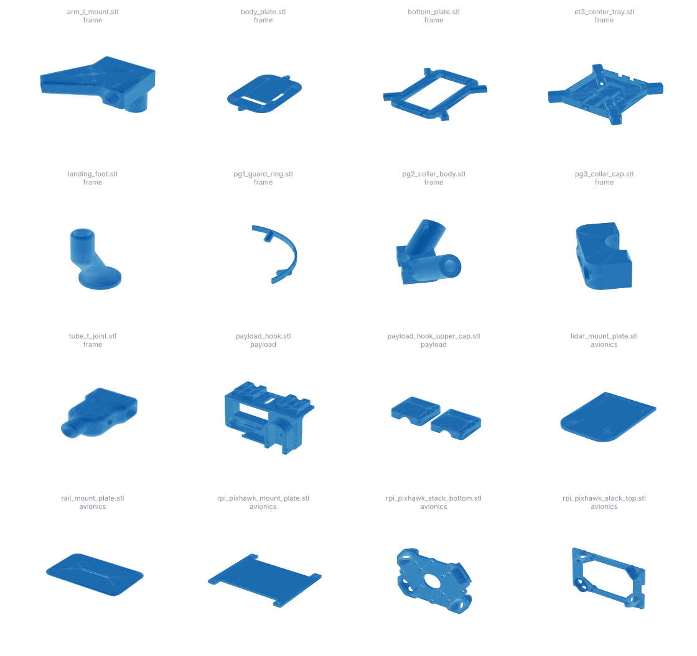

# CAD

These are the mechanical parts of the AVION airframe, all designed in-house. The frame uses carbon-fibre tubes joined by 3D-printed nodes, so any broken joint can be re-printed from these files in the field.

The parts are grouped by subsystem. Meshes (`.stl`) are ready to print. Solid models (`.step`) can be edited, and `.3mf` files are slicer projects.

The full airframe assembly is [`avion_assembly.step`](avion_assembly.step) (43 MB; Drive name `AVION ASSEMBLY.step`). The ground station's 3D digital twin (`flight_software/gui_assets/avion_twin.glb`) was exported from that assembly.

Part descriptions come from the geometry and the original file names. Sizes are bounding boxes in millimetres. The *Original name* column gives each file's name in the team's Google Drive.

## `frame/`: airframe structure

| File | Size (mm) | Description | Original name |
|---|---|---|---|
| `et3_center_tray.stl` | 181 × 181 × 21 | Central tray with four arm sockets | `ET3_tray_arm_aligned.stl` |
| `bottom_plate.stl` | 134 × 149 × 12 | Central bottom plate | `bottom plate updated.stl` |
| `body_plate.stl` | 132 × 222 × 6 | Body plate with strap slot | `Body6.stl` |
| `body_plate.3mf` | – | Slicer project for the body plate | `Body6.3mf` |
| `arm_l_mount.stl` | 59 × 59 × 37 | L-shaped arm-to-tube mount | `final L mount updated.stl` |
| `tube_t_joint.stl` | 30 × 52 × 17 | T-shaped tube joint | `final updated T mount.stl` |
| `pg1_guard_ring.stl` | 181 × 181 × 29 | Curved guard ring segment | `PG1_guard_ring.stl` |
| `pg2_collar_body.stl` | 51 × 51 × 31 | Angled two-tube collar, used with the PG3 cap | `PG2_collar_body.stl` |
| `pg3_collar_cap.stl` | 29 × 29 × 12 | Cap for the PG2 collar | `PG3_collar_cap.stl` |
| `landing_foot.stl` | 30 × 43 × 60 | Landing-gear foot (tube socket with round pad) | `Untitled.stl` |
| `tube_clamp_arm.step` | – | Tube clamp, arm half | `clamp_arm.step` |
| `tube_clamp_cap.step` | – | Tube clamp, cap half | `clamp_cap.step` |

## `payload/`: release mechanism

| File | Size (mm) | Description | Original name |
|---|---|---|---|
| `payload_hook.stl` | 80 × 42 × 49 | Servo-actuated release hook, driven from Pixhawk AUX1 | `payload hook.stl` |
| `payload_hook_upper_cap.stl` | 50 × 21 × 7 | Two-piece upper cap for the hook | `hook upper cap.stl` |

## `avionics/`: electronics and sensor mounts

| File | Size (mm) | Description | Original name |
|---|---|---|---|
| `rpi_pixhawk_stack_top.stl` | 89 × 12 × 61 | Raspberry Pi / Pixhawk stack mount, upper frame | `Ras_pix_top.stl` |
| `rpi_pixhawk_stack_bottom.stl` | 65 × 10 × 52 | Raspberry Pi / Pixhawk stack mount, lower frame | `Ras_pix_Bottom.stl` |
| `rpi_pixhawk_mount_plate.stl` | 64 × 55 × 2 † | Flat Raspberry Pi / Pixhawk mounting plate | `rpi_pixhawk_mount.stl` |
| `lidar_mount_plate.stl` | 80 × 110 × 5 | Rangefinder / LiDAR mounting plate | `plate_lidar.stl` |
| `rail_mount_plate.stl` | 78 × 50 × 16 | Rail mounting plate | `rail plate.stl` |
| `rs3_camera_cradle_v2.step` | – | Camera cradle, version 2 | `RS3_cradle (2) v2.step` |

† `rpi_pixhawk_mount_plate.stl` was exported at 1000× scale. Its raw bounding box is 64000 × 55000 × 2000 units, so scale it by 0.001 in the slicer.

Every file is a byte-identical copy of the Drive original. Only the names and folders changed.
