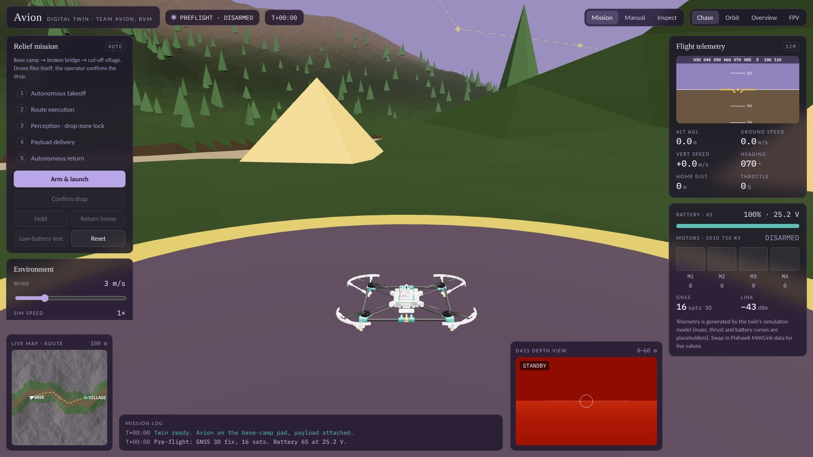

# Avion Digital Simulator

`avion_digital_simulator.html` is a self-contained 3D digital twin of AVION that runs in the browser. Download it and open it. The airframe model is embedded in the file, and three.js and the fonts load from a CDN, so it needs an internet connection.

## What it does

- **Mission mode.** Runs the full relief sortie on a terrain scene: base camp, then the broken bridge, then the cut-off village. The steps are autonomous takeoff, route execution, drop-zone lock, operator-confirmed payload drop and autonomous return. Controls: *Arm & launch*, *Confirm drop*, *Hold*, *Return home*, *Reset*, and a *Low-battery test* that triggers the failsafe.
- **Manual mode.** Fly the twin yourself.
- **Inspect mode.** Click any part of the airframe to see the assembly breakdown.
- **Cameras.** Chase, orbit, overview and FPV views.
- **Environment.** Adjustable wind and simulation speed.
- **Instruments.** Attitude indicator, altitude, speed, heading, throttle, home distance, 6S battery, per-motor output, GNSS, link quality, a simulated D455 depth view, a live route map and a mission log.

The telemetry comes from the twin's own simulation model, and its mass, thrust and battery curves are placeholders. The live ground station (`flight_software/gui_assets/gcs.html`) shows the same twin driven by real Pixhawk MAVLink data.
